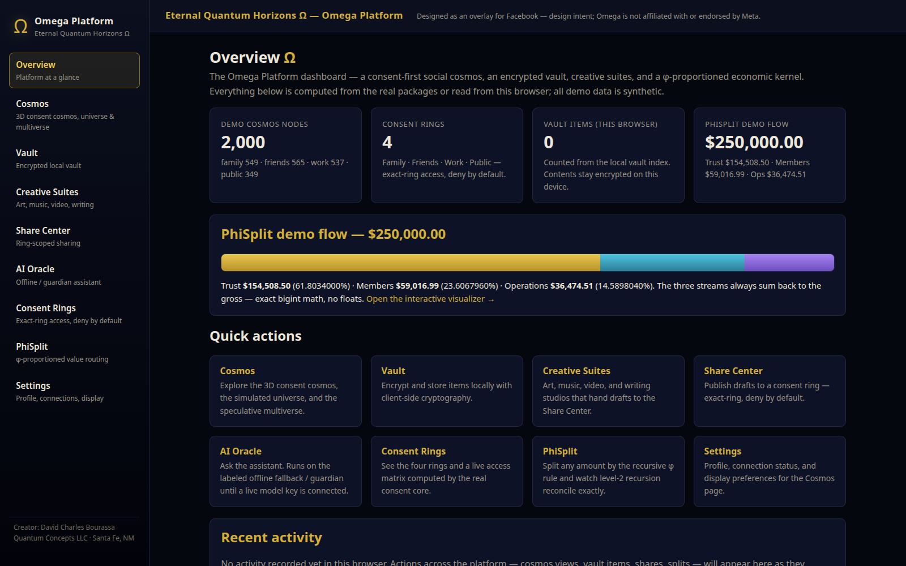
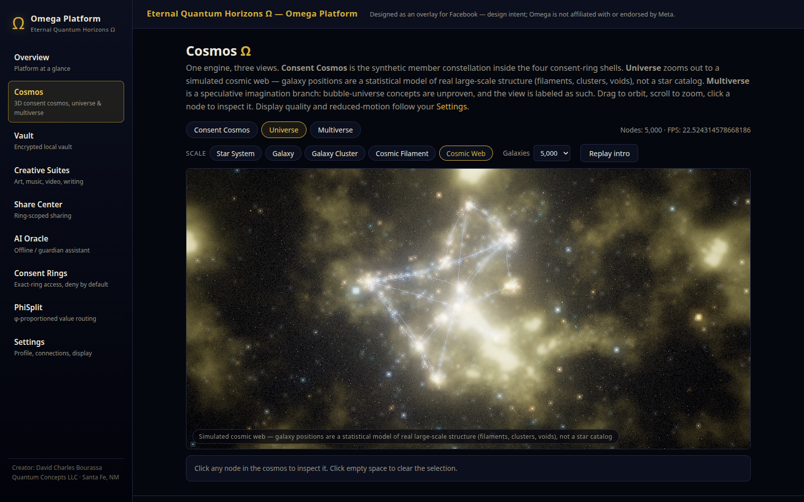
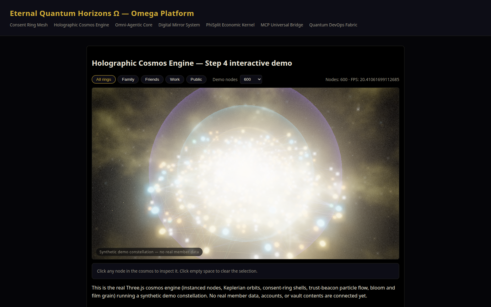

# Ω Eternal Quantum Horizons — Omega Platform

**Creator: David Charles Bourassa · Quantum Concepts LLC, Santa Fe, New Mexico**

> "No Artificial, Only Official Art."

## What this is

Omega is designed as an **overlay for Facebook** — a next-generation platform layer
(the "wrap-around bridge") that sits on top of a member's existing Facebook graph
rather than competing with it. Your friends, memories, creations, and communities
become a living 3D cosmos you can fly through; around them sit **consent rings**
(Family / Friends / Work / Public) that govern — cryptographically, not by policy
page — what any person or AI agent may see, an **encrypted vault whose keys the
member holds**, and a fabric of **AI agents grounded only in each member's own
data**, every output carrying a provenance badge. The graph arrives through the
MCP Universal Bridge's Meta adapter (Graph API where platform policy allows, user
data exports as fallback), and the AI core runs on Meta's own stack (Meta Model
API / Muse Spark). This is design intent, built in the open: nothing here implies
Meta endorsement, partnership, or approval.

> The project claims to be **the first social platform to combine a navigable 3D
> cosmos interface with a member-keyed encrypted data vault and a personal AI
> grounded solely in each member's own data — every output carrying an "official
> personal AI" provenance badge.** The claim is deliberately combination-scoped,
> and a prior-art analysis supporting the scoping is held in the project's
> records (outside this repository; not part of the hackathon submission).

**Entering the Meta Global AI Developer Hackathon 2026? Start with
[`HACKATHON.md`](HACKATHON.md)** — event facts, entry strategy, the
judging-criteria → evidence map, the build plan, and the demo script.

## The seven canonical layers

| Layer | Canonical name | Lives in |
| --- | --- | --- |
| Identity | **Consent Ring Mesh** | `packages/consent-core` |
| Visual world | **Holographic Cosmos Engine** | `packages/cosmos-engine` + `apps/web` |
| AI | **Omni-Agentic Core** | `packages/ai-core` |
| Legacy | **Digital Mirror System** | `packages/legacy-engine` |
| Economics | **PhiSplit Economic Kernel** | `packages/economic-kernel` + `contracts/` |
| Connectors | **MCP Universal Bridge** | `packages/mcp-gateway` |
| Deployment | **Quantum DevOps Fabric** | `infra/`, Turborepo, CI, `docs/adr/` |

Full architecture and taxonomy: [`docs/architecture/ARCHITECTURE.md`](docs/architecture/ARCHITECTURE.md).

## Honest status — what works, what is scaffold

This is a working foundation, not a launched product: no users, no revenue, no
deployed contracts, no live Meta integration yet. Every component is labeled by
maturity, and the labels match reality:

| Component | Status |
| --- | --- |
| `packages/cosmos-engine` | **Working** — real Three.js engine: single-draw-call instanced nodes, consent-ring shells, Trust Beacon particle flow, fbm nebula shader, bloom + film grain; **Universe mode** (seeded cosmic-web generator — filaments, clusters at intersections, true voids; galaxies colored by class: spiral blue-white, elliptical warm gold, irregular cyan) and a **Multiverse view** (bubble universes, labeled speculative in-product); scale levels, cinematic intro flythrough, birth-shimmer transitions, camera auto-framing on every dataset load (bounding-sphere fit in the engine, so a 29-node imported graph and the 600-node demo each fill the frame), and an automatic quality-degrade step-down that keeps the scene smooth on weaker machines; **stellar physics** (Phase 4): every member is a star whose **mass grows with their friend count** (log-scaled), whose **density and brightness grow with their follower count** at exactly unchanged mass (denser = slightly more compact, hotter/bluer, brighter) — a pure, contract-tested model (`stellar.ts`) driving node size, colour temperature, emissive intensity, and halo particles, with Friends / Followers / Mass / Density / Brightness readouts in the node inspector and the plain-language legend "Friends make a star massive. Followers make it dense and bright."; 119 tests |
| `apps/web` | **Working dashboard** — twenty routes (Overview, Public Platform, Cosmos, Import Archive, Vault, Creative Suites, Share Center, Communities, AI Oracle, Omni-AI Agents, Review Workstation, Eternal Garden, Consent Rings, Privacy Control Center, PhiSplit, Guided Demo, Operator Control, Settings), all functional locally; the Privacy Control Center runs the Universal Access Engine live (permission matrix, access preview, temporary passes, consent dashboard, audit log, governed emergency-access flow) and its Five-Viewer Demonstration renders one synthetic member's world as five different authorized views; the **Review Workstation** (`/review`) runs the Omni execution engine live — agent proposals that activate only on a human approval, plans approved whole with per-step veto, every executed step policy-evaluated with receipts — and its guided **Omni Demonstration** (`/review/demo`) performs the critical demonstration end to end (community created, three specialized agents proposed and approved, authorized evidence gathered through the gateway, findings organized, an educational draft filed to the Share Center, launch checklist, and the community + agents added to the cosmos, visible on `/communities` and `/cosmos`); the Import Archive page parses a Facebook export **entirely in the browser** (labeled "Imported archive — processed locally, nothing uploaded") and the Cosmos page switches between the synthetic demo dataset and the imported one; synthetic demo data, labeled as such |
| `packages/economic-kernel` | **Working** — exact recursive φ split in bigint minor units (Trust 61.8033988% / Members 23.6067976% / Operations 14.5898036%); property-tested over 1,000 amounts; plus the **public disclosure facade** (`buildPublicDispersionPayload` / `sanitizePublicLedgerPayload` / `assertPublicSafe`): an allowlist-sanitized payload carrying only the member dispersion total, leakage-tested against forbidden keys at any depth; 35 tests |
| `packages/consent-core` | **Working** — ring types, consent receipts, `canAccess` checks; plus the **sync module**: sync events (`SyncEventLog`), context caches, and `revokeConsentAndPurge` — revocation that purges AI/connector cached context for the subject + ring and records the purge as events; 25 tests |
| `packages/policy-engine` | **Working** — the Universal Access Engine: subjects (people + agents), resources classified into 10 data domains, 8 actions, relationship groups beyond the rings (healthcare providers, employers, research collaborators, legacy stewards…), purpose-limited grants and expiring temporary passes, explicit denials that **win over group grants**, deny-by-default `evaluate()` over the full tuple (subject + resource + action + purpose + relationship + consent + policy + context + expiration), an audit event per decision, consent-registry queries, and legacy directives (lifetime vs post-death policy, designated stewards, never-public domains); composes consent-core's sync primitives so grant revocation purges cached context; 51 tests incl. a 28-case security matrix proving the five-viewer demonstration scenario. Enforcement lives in this package on every demo data path — the production server schema is a labeled design artifact (`docs/PRODUCTION_SCHEMA.md`), not deployed |
| `packages/vault-core` | **Working** — Sovereign Vault crypto: per-item AES-GCM encryption (WebCrypto) with item keys wrapped per consent ring (AES-KW — unwrapping with the wrong ring's key fails); 12 tests incl. round-trip and wrong-ring rejection. Local browser storage only — no server persistence yet |
| `contracts/` — PhiSplitRouter, ReserveVault, MerkleAnchor | **Working testnet-grade code** — Foundry suite 9/9 incl. fuzz; **unaudited — not for real funds** |
| `packages/ai-core` | **Working (offline) + Meta Model API adapter** — the canonical **8-agent fabric** (`AGENT_FABRIC`: Oracle, Consent Guardian, Memory Curator, Avatar, Legacy Mirror, Studio, Connector, Economic Steward) with a consent-gated runtime (`runAgentTask`: ring-scope gate → Guardian consent pre-gate → capability → step receipts + run receipt; the original six role definitions are kept for existing consumers); a Muse Spark chat adapter with a deterministic offline fallback; the ring-scoped **Oracle answering layer** (`answerOracleQuery`): in-ring answers cite their demo sources, out-of-ring questions get a visible **Guardian refusal** naming the ring boundary; a **Legacy Mirror module** (`src/legacy/`): provenance-cited Q&A over a synthetic life archive that abstains rather than inventing memories; a Muse Image client with a Creative→Vault provenance seam; and one env signal that flips every AI surface LIVE/OFFLINE, badging the answering model. Docs check (Oct 26 2026, graded findings in `docs/META_API_NOTES.md`): the base URL `https://api.meta.ai/v1` is confirmed by Meta's own public example; the default model is the newest documented Spark id, `muse-spark-1.3`, with `muse-spark-1.1` — the id in Meta's example — kept as a pinned fallback. Still **untested against the live API — no key yet**; the **Omni execution layer** (`registry.ts` / `planner.ts` / `execution.ts` / `omni-demo.ts`): a data-driven agent registry where a proposal becomes an active agent only through a person's approval (agent approvers and activation without approval throw), a **live-capable planner** (Phase 4): when a Meta Model API key is configured, `MetaModelClient` drafts the plan in the same typed schema — and because model output is untrusted, every drafted step is validated against the agent registry, the gateway tool registry, and the plan's own earlier agent proposals before the plan exists (hallucinated tools, unknown agents, and malformed JSON are rejected loudly with all reasons recorded); with no key, the deterministic offline planner emits the identical schema (planner mode is badged per plan: LIVE only for a plan actually drafted live, OFFLINE otherwise); a **skills system** (`skills.ts` / `skill-guard.ts`): versioned skill modules over gateway tools (seed library: Evidence Research, Community Launch, Archive Curation, Findings Writing, Graph Analysis) that agents hold via their registry definitions — at execution a tool step must be covered by the agent's allowlist **and** one of its skills, or it is refused with the reason; **run reflections**: every completed run gets a summary in its versioned vault record — written by the live model when keyed, a deterministic template otherwise, with the source labeled in the record and in the Review Workstation's agent monitor (per-agent run history = agent memory); and an executor that runs only approved, non-vetoed steps in order — each step gated by a policy-engine `evaluate()` under a purpose-limited, task-expiring pass issued by the member-owner (agents can never source their own grants), every step receipted into a versioned vault run record, denied or out-of-scope steps refused visibly with the engine's reason; 165 tests (incl. the directive-§6 policy-agent capabilities over `@omega/policy-engine`: Privacy Guardian conflict scan, Security Review audit, proposals-only Relationship Intelligence, the execution-model suite: unapproved plan cannot execute, vetoed step never runs, out-of-scope step refused with zero tool calls, task pass expired after run completion — and an end-to-end test proving a free-form goal plans, approves, and executes through the generic Research Agent definition) |
| `packages/meta-export` | **Working** — Facebook "Download Your Information" ingest: a synthetic DYI-shaped fixture generator (fictional owner, labeled synthetic), a parser/normalizer (export files → member graph), deterministic ring inference (friend lists → frequency heuristic → deny-by-default, with manual overrides), and a converter to the cosmos dataset; 41 tests |
| `packages/mcp-gateway` | **Working** — MCP Universal Bridge core: a transport-agnostic JSON-RPC 2.0 tool gateway (`tools/list`, `tools/call`, stdio transport) with a tool registry and a pure, browser-importable **adapter catalog of 10 adapters (18 tools)**: Meta-export (`graph.summary`, `graph.listPeople`, `graph.searchPosts` over a normalized member graph), notes, and files (path-traversal guard) working; **GitHub and Notion working over synthetic fixtures**; **Stripe sandbox** (fixtures, `livemode: false`); AWS / Cloudflare / Hugging Face / Home Assistant stubs. Infrastructure: rate limiter, circuit breaker, PKCE helpers, token vault, and per-call tool receipts; protocol aligned to **MCP 2026-07-28** (`server/discover`; supported versions 2026-07-28 / 2025-11-25); protocol-level tests, 72 tests. Browser-safe entry at `@omega/mcp-gateway/browser` (the pure registry/protocol/adapter surface incl. `createDemoGateway`; node-only stdio transport, disk file provider, token vault, and PKCE stay on the package root — a guard test walks the browser entry's import closure and asserts no `node:` builtin is reachable). No HTTP transport or auth yet |
| `packages/legacy-engine` | **Working (mechanical core)** — the Continuity Engine's heart: a versioned memory vault over the Eternal Garden archive (append-only versions; every mutation issues a receipt; nothing is silently rewritten) plus a consistency scorer that flags claims contradicting the archive and claims with no archival support — the real-data-only rule in code; 23 tests. No persistence layer yet |
| `packages/ui` | SCAFFOLD — canonical type surfaces only |
| `contracts/` — MemberPool, TreasuryRegistry | SCAFFOLD stubs |
| `apps/docs`, `apps/worker` | SCAFFOLD stubs |

**Gate status (recomputed Oct 28 2026):** full turbo gate green —
`turbo build typecheck lint test` **48/48 tasks** · vitest **543
tests** passing (cosmos-engine 119, ai-core 165, mcp-gateway 72,
policy-engine 51, meta-export 41, economic-kernel 35, consent-core 25, legacy-engine 23,
vault-core 12) · forge **9/9** · `@omega/web` production build green
(20 routes) and lint clean (0 errors). Render verification: the Oct 23
headless capture verified the consent cosmos (screenshots below); on Oct 26 the
eleven-route dashboard (including the Eternal Garden and the Guided Demo) was
captured the same way — all routes render with zero console errors, and a
scripted pipeline walked the demo beats into a silent DRAFT video
(`docs/demo-video/`). On Oct 27 the full import flow was browser-verified
end-to-end: synthetic sample export → import summary (28 people ring-assigned,
11 unclassified held in the most restrictive ring) → the imported graph
rendered in the consent cosmos with ring filtering live (screenshots:
`docs/images/phase3-import-result.png`,
`docs/images/phase3-imported-cosmos.png`,
`docs/images/phase3-imported-cosmos-family.png`). On Oct 28 the
Privacy Control Center and the Five-Viewer Demonstration were captured the
same way — the Doctor's access preview allows exactly the two synthetic
healthcare records (grant-cited) and nothing else, and the Family view of
the demonstration unlocks only the family-heritage records and the memoir
(screenshots: `docs/images/phase3c-privacy.png`,
`docs/images/phase3c-privacy-preview-doctor.png`,
`docs/images/phase3c-demo-family.png`). On Oct 28 the Omni
execution flow was browser-verified end to end the same way: the guided
demonstration ran generate → approve → execute to **RUN COMPLETED, 10/10
steps executed** with a vault receipt, a workstation proposal was approved
into an ACTIVE agent, the created community showed its published
educational post and members, and the cosmos carried the Omni additions
chip at 604 nodes (screenshots: `docs/images/phase3b-review-demo.png`,
`docs/images/phase3b-review-workstation.png`,
`docs/images/phase3b-communities.png`,
`docs/images/phase3b-cosmos-omni.png`). Later on Oct 28 the
optimization + completion pass re-verified the final tree end to end: a
full twenty-route headless sweep of the production build rendered every
route with **zero console errors**, the Privacy Control Center's typed
rewrite re-produced the Doctor's preview exactly (the same two healthcare
records, grant-cited), the seven key pages showed no horizontal overflow
at 390 px, and the cosmos captures show the new camera auto-framing — the
imported 29-node graph dollied in and the 600-node demo pulled back to
contain the full public shell (screenshots:
`docs/images/phase-opt-cosmos-demo.png`,
`docs/images/phase-opt-imported-cosmos.png`). The surface-by-surface
completion audit for this pass is `docs/COMPLETION_AUDIT.md`. Captures ran
under software rendering, so **no performance figure is claimed anywhere** —
the demo's FPS readout shows the live number on real hardware. The economic model (φ-split routing, trusts,
"perpetual" provisions) is a design specification — any enforceable deployment
requires legal, tax, securities, and privacy counsel plus an independent
contract audit (see `docs/adr/0002-recursive-phi-split.md`).

## Quickstart

```bash
pnpm install
pnpm --filter @omega/web dev   # the cosmos demo (Next.js dev server)
pnpm typecheck                 # tsc --strict across every app/package
pnpm lint                      # eslint
pnpm test                      # vitest suites (543 tests)
cd contracts && forge test     # Foundry suite (9 tests; Foundry at ~/.foundry)
```

## Demo walkthrough (apps/web)

The web app is a twenty-route dashboard. Everything runs locally in the browser;
all demo data is **synthetic** and labeled as such in-product.



*Captured from the production build (headless browser, Oct 26 2026).*

- **Overview** — stat cards computed live from the real packages (demo cosmos
  node counts per ring, vault items stored in this browser, the exact φ split
  of a $250,000 demo flow), an activity feed fed by actions across the app,
  and an honest working-vs-scaffold summary.
- **Vault** — drag-and-drop upload with **real client-side encryption**:
  every file gets its own AES-GCM key, wrapped under the key of the consent
  ring you assign it to (`@omega/vault-core`). Decrypt-and-verify proves the
  round-trip by SHA-256; unwrapping with another ring's key fails. Local
  demo scope: ciphertext lives in this browser only.
- **Creative Suites** — Art / Music / Video / Write studios: local projects,
  an AI prompt composer (offline fallback visibly labeled until a Meta Model
  API key exists), and one-click handoff of any project to the Share Center.
- **Share Center** — compose a share, pick the ring audience, render a
  share-card preview on canvas, copy the text or export a PNG. Labeled demo:
  nothing posts anywhere.
- **AI Oracle** — chat over the demo cosmos, scoped to the active ring.
  Answers cite the in-ring nodes they used and are badged by which backend
  answered (live / offline fallback). Ask about another ring's node and the
  **Guardian refuses**, naming the boundary — the demo's consent beat.
- **Eternal Garden** — the Legacy Mirror over a **synthetic** 32-memory life
  archive (fictional member, labeled in-product): memories cluster by era in a
  garden view; clicking one opens its provenance card. Its Q&A cites a source
  memory for every claim, **abstains when the archive doesn't support an
  answer — it never invents a memory** — and the Guardian refuses askers
  outside the Family ring.
- **Guided Demo** — the two-minute demo script as clickable, captioned steps
  (cosmos → ring switch → Oracle → Guardian refusal → φ close), so the live
  demo holds up under pressure; the engine also steps its own quality down
  automatically if frame times degrade.
- **Consent Rings** — the four rings plus a live access matrix computed with
  the real `canAccess` (exact-ring, deny-by-default; revoked and expired
  receipts shown failing).
- **PhiSplit** — type any amount and watch the recursive φ split reconcile
  exactly, two levels deep: trust + members + ops === gross, always. The
  page is labeled as what it is: the member/personal console
  (privileged-private), where the full split is visible to the member alone.
- **Public Platform** — the disclosure-filtered public shell: the
  member-dispersion payload (built, sanitized, and asserted public-safe in
  code, rendered as visible JSON — only the allowed keys exist), public
  connector status (name + status only), and the privacy principles.
- **Omni-AI Agents** — the 8-agent fabric rendered from the registry, with
  a console that runs canned tasks through the real `runAgentTask`:
  Oracle answers, Guardian access explanations, a disclosed Legacy Mirror
  answer, a Connector consent preview (never executes), and a Steward
  member-audience run that returns only the member dispersion total —
  every run showing its step receipts and run receipt, badged with the
  honest LIVE/OFFLINE environment status.
- **Operator Control** — system status computed from imported package
  state (ai-core / legacy-engine / ui constants, the adapter catalog, the
  fabric count), contracts as documented status (unaudited, testnet-grade,
  not deployed), a live **revoke-and-purge demo** over consent-core's sync
  API on synthetic data, the per-route disclosure classification, and the
  runbook list (two exist; four are labeled PLANNED).
- **Settings** — profile, honest connection status (Facebook overlay and
  Meta Model API both "not connected — design intent / no key"), and
  quality / reduced-motion toggles that genuinely change the Cosmos page.

### The Cosmos page — three views, one engine



*Universe mode, 5,000 galaxies, captured from the production build (Oct 26 2026).*

1. **Consent Cosmos.** The synthetic member constellation inside the four
   consent-ring shells around the golden Trust Beacon. The ring switcher
   (All / Family / Friends / Work / Public) re-lights the universe — nodes
   outside the active ring dim to ghosts. Node-count control re-seeds at
   **600 / 2,000 / 5,000 nodes**; click any node to inspect it and fly to it.
2. **Universe.** A seeded simulation of real large-scale structure
   (`createUniverseData`, spec: [`docs/UNIVERSE_MODEL.md`](docs/UNIVERSE_MODEL.md)):
   galaxies concentrated along filament spines, dense clusters where
   filaments cross, true voids between — colored by galaxy class. Scale
   buttons ride the camera through the hierarchy: Star System → Galaxy →
   Galaxy Cluster → Cosmic Filament → Cosmic Web.
3. **Multiverse.** The member cosmos as one bubble among variant universes
   with distinct palettes and parameters, each focusable. Labeled
   **SPECULATIVE** in-product — bubble-universe concepts are unproven, and
   the view presents them as an imagination branch, not a finding.

Every view opens with a cinematic intro flythrough (skippable, and cut
entirely under reduced-motion), and mode switches bloom in with a
birth-shimmer transition.



*The consent cosmos (Oct 23 2026 capture). The
[Family-filter view](docs/images/cosmos-demo-family.png) shows the same scene
with the outer rings dimmed by the consent filter.*

When real vault data exists, it enters through the engine's `setData` seam —
the demo data generators are stand-ins behind that seam, not shortcuts around it.

## Layout

```
apps/
  web/        Next.js (App Router) — 17-route dashboard   [WORKING]
  docs/       Documentation portal stub                 [SCAFFOLD]
  worker/     Cloudflare Worker edge runtime stub       [SCAFFOLD]
packages/
  consent-core/     Consent Ring Mesh types + access checks   [WORKING]
  policy-engine/    Universal Access Engine (domains×purposes) [WORKING]
  economic-kernel/  PhiSplit φ math (exact, bigint)           [WORKING]
  cosmos-engine/    Holographic Cosmos Engine (Three.js)      [WORKING]
  vault-core/       Sovereign Vault crypto (AES-GCM + AES-KW) [WORKING]
  ai-core/          Omni-Agentic Core + Meta Model adapter    [WORKING — offline path + adapter]
  meta-export/      Facebook export ingest (parser + rings)   [WORKING]
  mcp-gateway/      MCP Universal Bridge JSON-RPC gateway     [WORKING]
  legacy-engine/    Continuity core (versioned vault+scorer) [WORKING]
  ui/               Design system primitives                  [SCAFFOLD]
contracts/    Solidity 0.8.24 PhiSplit contract suite (Foundry)
infra/        CI (GitHub Actions), Cloudflare, Hardhat, Foundry notes
docs/         ARCHITECTURE.md + ADRs 0001–0004
```

## Go deeper

- [`HACKATHON.md`](HACKATHON.md) — Meta Global AI Developer Hackathon 2026 entry:
  strategy, evidence map, build plan, demo script.
- [`docs/architecture/ARCHITECTURE.md`](docs/architecture/ARCHITECTURE.md) — the
  Step 1 canonical architecture and product taxonomy.
- [`docs/UNIVERSE_MODEL.md`](docs/UNIVERSE_MODEL.md) — the research spec behind
  Universe/Multiverse modes: which visual choices are grounded in real
  large-scale structure, which are labeled speculative, with sources.
- [`SUBMISSION.md`](SUBMISSION.md) — the portal-ready hackathon write-up,
  mapped to the official judging criteria.
- [`docs/META_API_NOTES.md`](docs/META_API_NOTES.md) — the graded Meta Model
  API research record behind the adapter defaults (Spark, Muse Image, SAM 3.1).
- [`docs/public/`](docs/public/) — the public-safe documentation set:
  overview, the member-dispersion payload and disclosure rule, privacy
  principles, and connector transparency (names + statuses).
- Further project records — the full implementation plan, the v9.0 product
  blueprint, the visual blueprint pack, the whitepaper, and the pitch deck —
  are held **outside this repository** and are **not part of the hackathon
  submission** (submission scope is this monorepo only; see the licence note in
  `HACKATHON.md` §7).
- The earlier M0 build (FastAPI prototype, held outside this repository) is a
  prototype service layer; **this monorepo is the canonical foundation** going forward.

## Canonical decisions (ADRs)

- `docs/adr/0001-typescript-monorepo.md` — pnpm + Turborepo + TS strict is the foundation.
- `docs/adr/0002-recursive-phi-split.md` — recursive φ split is the only canonical math
  (Trust 61.8033988% / Members 23.6067976% / Operations 14.5898036%); "62/38" is UI shorthand only.
- `docs/adr/0003-aes-gcm-client-vault.md` — AES-GCM per item + per-ring wrapped keys is the client vault standard.
- `docs/adr/0004-attribution-name.md` — creator attribution is **David Charles Bourassa**.

## Licence

Proprietary — © 2026 Quantum Concepts LLC, all rights reserved. See the
[`LICENSE`](LICENSE) file at the repository root. A limited grant in that
file lets the Meta Global AI Developer Hackathon 2026 organizers and judges
read, clone, and run the code solely to evaluate this submission.
